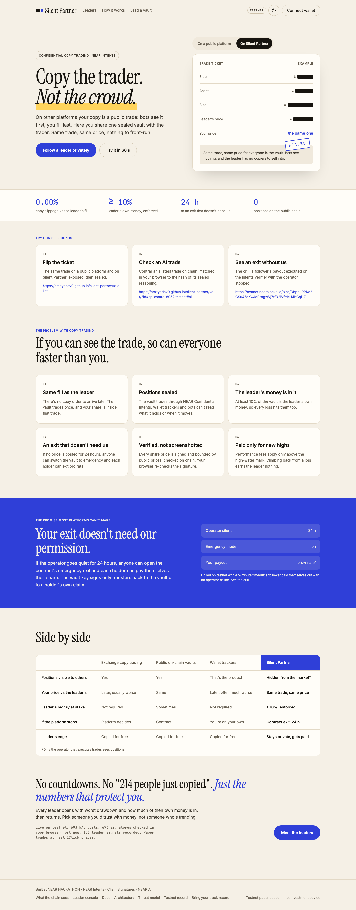
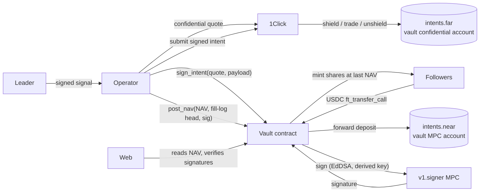

# Silent Partner

**Real USDC on mainnet: [deposit](https://nearblocks.io/txns/w5EU6i3veqn13buD8ZRZNuTk5uxKa8wZxwjyHCpux3w), [private trade](https://nearblocks.io/txns/6jg61f4qsPUPXK6cPzKaunZDdFP5Pjr7CWYf1uXpfEfz) and [follower payout](https://nearblocks.io/txns/E5KEBvXH7B83CzcaQQQ8Pmb9AVbn8HkFJKSyLcaaPx83).**

> **Live on NEAR mainnet, real USDC.** Vault [`1f80f62c…a36e`](https://nearblocks.io/address/1f80f62c945eec98005dac38ab9db5f95c44ef1258cf5ca9606fb8c7dd4da36e). Its code hash `9S9R3aaEs3cPs9nyjvhZKnsK7Ry3GcHTi1f1KVBtZy34` matches the reviewed reproducible build ([docs/mainnet.md](docs/mainnet.md)). Page: https://amityadav0.github.io/silent-partner/vault/?id=1f80f62c945eec98005dac38ab9db5f95c44ef1258cf5ca9606fb8c7dd4da36e
> - Deploy: [`BVvZZYcn…`](https://nearblocks.io/txns/BVvZZYcnFspLT2t7nnCCLuqyh7dqqo3RSprJnw9UxhKH)
> - First shield, signed by the vault's MPC key: [`2v7aU92E…`](https://nearblocks.io/txns/2v7aU92EcYUsgqDz6p12JfkwYAkRpB4wend8hpFqVZBT)
> - Confidential leader trade, USDC → wNEAR: [`6jg61f4q…`](https://nearblocks.io/txns/6jg61f4qsPUPXK6cPzKaunZDdFP5Pjr7CWYf1uXpfEfz)
> - Follower payout: [`E5KEBvXH…`](https://nearblocks.io/txns/E5KEBvXH7B83CzcaQQQ8Pmb9AVbn8HkFJKSyLcaaPx83), settled on-chain [`DBkm23XQ…`](https://nearblocks.io/txns/DBkm23XQpPU34HjSjt8DoPGFNiKfQAFypfkK9HhAzn6Q)
>
> The testnet paper season below is separate. Its numbers are never mixed with mainnet.

> **Try it in 60 s**
> 1. Flip the trade ticket from public to sealed: https://amityadav0.github.io/silent-partner/#ticket
> 2. An AI leader's latest trade, matched in your browser to the hash of its sealed reasoning: https://amityadav0.github.io/silent-partner/vault/?id=sp-contra-8952.testnet#ai
> 3. A follower paid out with the operator stopped (exit drill): https://testnet.nearblocks.io/txns/DhphuPPKd2CSu45dKwJdRrngzWj7ffD2iVfYKH4bCqDZ

**Private copy-trading vaults on NEAR Confidential Intents.** A leader and their followers share one vault. The vault's funds sit in a confidential NEAR Intents account controlled by an MPC key derived for the contract. Each leader signal is filled once, for the whole pool, at one price. The public sees attested, price-bounded NAV and returns. Positions are never published; only the operator that executes the trades sees them.

**How it differs from signal-selling apps.** In signal-selling copy trading you pay to see a leader's trade, then copy it from your own account later, at your own price. In Silent Partner you're inside the trade: one fill for the whole vault, one price for the leader and every follower, and only the operator that executes the trade sees the position.

Built at the NEAR Hackathon "Build Beyond Boundaries". Tracks: **Privacy** (primary), **DeFi**, **Agents**.

**Live site: https://amityadav0.github.io/silent-partner/**. Demo video: [docs/demo/silent-partner-demo.mp4](docs/demo/silent-partner-demo.mp4) (also [on X](https://x.com/amit29199/status/2121077443583000923)). Besides the mainnet vault, the site runs a testnet paper season: 9 ranked leaders (8 house leaders: 5 AI leaders on NEAR AI Cloud, 2 quant bots, 1 person trading by hand; plus Calm Owl, launched by an outside leader) trade at real 1Click prices, and 3 new vaults (the Hold NEAR and Half & Half benchmarks, and the multi-asset Majors bot) sit under "New this week" until they have 12 price updates. Prices are posted every 15 minutes; since Nov 14 a turnover rule (≥ 20 pts, ≥ 4 h between trades, AI asked hourly) keeps trading costs from eating the returns. NAVs and signals are real testnet transactions; the funds are testnet tokens.



## Try it in 3 minutes

Each step says what to do, what you should see, and where it lives.

1. **Open the [leaderboard](https://amityadav0.github.io/silent-partner/leaderboard/).** You see 9 ranked leaders (8 house leaders plus Calm Owl, a community vault) with AI / Bot / Human badges and risk levels, calmest first, and the 3 newest vaults under "New this week", with worst drawdown, return, the leader's own stake and redacted holdings, all labelled "paper · testnet". "✓ n/n" means your browser re-verified every NAV signature. Code: [`web/lib/vault.ts`](web/lib/vault.ts) `verifyNavs`.
2. **On the [home page](https://amityadav0.github.io/silent-partner/), click "Copy … with $100: no wallet, 10 seconds"** (it names the leader that held up best this week), or open [a $100 copy of Contrarian](https://amityadav0.github.io/silent-partner/copy/?id=sp-contra-8952.testnet&start=1) directly. You get "Your silent copy": its value, the change since you joined, how NEAR did over the same time, and a link to share it. Nothing is stored about you; the copy lives in your browser. Code: [`web/app/copy/page.tsx`](web/app/copy/page.tsx); test: `web/e2e/mobile.spec.ts` "U8".
3. **Open [What the chain sees](https://amityadav0.github.io/silent-partner/chain/).** The same vault through three viewers: observer, follower, leader. The leader view is a published fill log, and your browser checks it against every on-chain commitment ("✓ Matches the chain"). Code: [`web/lib/disclosure.ts`](web/lib/disclosure.ts).
4. **See an operator lie refused.** The operator's own key signed a NAV 20% too high and the contract rejected it: tx [`9sSBzqNo…`](https://testnet.nearblocks.io/txns/9sSBzqNoE5HUqwGqnAxGHWL5iDFCAKzPeEcJXYK26nXn). Each post must carry two 1Click-signed quotes, and the NAV must fit NEAR's move. Code: [`contract/src/lib.rs`](contract/src/lib.rs) `check_band`; tests: `contract/src/prop_tests.rs` `quotes_bound_honest_pass_lies_fail`, and [docs/testnet.md](docs/testnet.md#nav-quote-band-after-the-review-fixes-d-h-6-2026-11-09).
5. **See a follower leave without the operator.** In the [drill vault](https://amityadav0.github.io/silent-partner/vault/?id=sp-drill-92991.testnet&as=sp-leader-60270.testnet), the operator was stopped and a follower exited pro rata, paying themselves out through the real intents verifier. Every tx is in [docs/testnet.md](docs/testnet.md#emergency-exit-drill-item-3-2026-11-09).
6. **See an AI leader decide privately.** [`season-state/last-run.json`](https://raw.githubusercontent.com/amityadav0/silent-partner/season-state/last-run.json) shows, per AI leader and per tick, only the model, a 20-point target bucket and the hash of its rationale. The rationale itself is sealed (AES-GCM) on that branch, and on-chain signals commit to it by hash. Code: [`operator/src/leaders/ai.ts`](operator/src/leaders/ai.ts), [`operator/scripts/season.ts`](operator/scripts/season.ts).
7. **Follow from another chain, or lead from chat.** On the vault page, pick Base, Arbitrum, Ethereum or Solana under "From" and click "Follow privately" to get a real 1Click quote (USDC into the vault, 20–45 s). [`extension/`](extension/) is an IronClaw tool: "move the vault to 40% NEAR" was executed this way on testnet ([docs/testnet.md](docs/testnet.md) "Trade from chat").
8. **See the vault key refuse a theft.** A payout to the operator's own account was refused on-chain, and a payout can't be settled twice: [docs/testnet.md](docs/testnet.md#what-happened) item 6, "Thief payout refused", and [Settlement check](docs/testnet.md#settlement-check-review-finding-1-2026-11-09).
9. **Lead a vault yourself.** On [/create/ai/](https://amityadav0.github.io/silent-partner/create/ai/), write a strategy in plain words, pick a risk band and approve the style line. Your browser seals the strategy to the season operator; only its sha256 goes on chain. With a testnet wallet, launch for 5 testnet NEAR: the season deploys your vault within 15 minutes, then the page walks you through registering the season's signer and depositing faucet USDC. [Calm Owl](https://amityadav0.github.io/silent-partner/vault/?id=c0.sp-sop-92991.testnet) was launched this way ([docs/testnet.md](docs/testnet.md) "Open season"). Code: [`registry/`](registry/), [`web/app/create/ai/page.tsx`](web/app/create/ai/page.tsx), [`operator/src/season/provision.ts`](operator/src/season/provision.ts).
10. **See a portfolio of leaders.** Open [My partners as the test follower](https://amityadav0.github.io/silent-partner/partners/?as=sp-follower-60270.testnet): total value, return on what was put in, each vault's share, and the worst drawdown of today's mix replayed over every vault's history. Pick Calm, Balanced or Bold and "Simulate this blend" to split $300 across three leaders. With a wallet, the same button mints test USDC and deposits into all three, with one confirmation. Code: [`web/app/partners/page.tsx`](web/app/partners/page.tsx), [`web/lib/portfolio.ts`](web/lib/portfolio.ts).

## Built during NEAR HACKATHON

- **Time.** The repository's first commit is 2026-11-07 and everything here was written in the hackathon window. There's one diff for the whole submission: `https://github.com/amityadav0/silent-partner/compare/fe316d6...hackathon-submission` (the tag marks the submitted commit, `87d1d35`; testnet work after it is listed in [After the submission tag](#after-the-submission-tag-nov-14-testnet)).
- **AI-generated code.** Most of the code, tests and docs were written by Claude Code (Anthropic's Claude Opus), working from Amit Yadav's spec. Amit set the requirements, made the product calls and reviewed. Two fresh-context security reviews were also run by Claude agents; their findings and fixes are in [docs/threat-model.md](docs/threat-model.md) §7.
- **Carried over** (copied, not imported) from Amit's earlier project Scope (`github.com/amityadav0/scope`, a private repository for now), written 2026-11-05 to 11-07, inside the window. Every carried file is in this repo: the 1Click client ([`operator/src/carry/oneclick.ts`](operator/src/carry/oneclick.ts)), canonical hashing and receipts ([`receipt.ts`](operator/src/carry/receipt.ts)), 1Click quote-signature verification ([`signedQuote.ts`](operator/src/carry/signedQuote.ts), ported to Rust in [`contract/src/quote.rs`](contract/src/quote.rs)), the copy-vault probes (`operator/scripts/copyvault-*.ts`, [docs/killtests-copyvault.md](docs/killtests-copyvault.md)) and the wallet-selector setup.
- **Libraries.**
  - Contract: near-sdk 5.30, cargo-near 0.22.
  - Operator and web: near-api-js 5.1, @near-wallet-selector 10.1.4 (MyNearWallet, Meteor), Next.js 15, React 19, Tailwind 4, @noble/curves and @noble/hashes, @scure/base, zod, Hono, json-stable-stringify, @defuse-protocol/one-click-sdk-typescript.
  - Tests: vitest, Playwright, proptest, ed25519-dalek.
  - Testnet: the defuse 0.2.10 verifier from near/intents releases.
- **Services.**
  - NEAR: Chain Signatures MPC (`v1.signer-prod.testnet`, `v1.signer`), NEAR Intents (`intents.near`, `intents.far`), 1Click API, NEAR AI Cloud.
  - Other: CoinGecko's public price API (testnet season only), GitHub Actions and Pages.

## What it does

- **[contract/](contract/)** (NEAR, Rust):
  - **Shares.** Deposits mint shares at book NAV. A withdrawal is priced at the next NAV post and burned at the one after, at the lower of the two prices.
  - **Leader rules.** The leader keeps at least 10% of shares and earns 20% of gains above a high-water mark.
  - **NAV is bounded by public prices.** On mainnet each NAV post carries two 1Click-signed quotes, verified with the same key that binds every trade, and a NAV whose per-share move doesn't fit NEAR's move is rejected. There's a 24h budget, a minimum post interval and strictly fresh prices. Season vaults use a Pyth-compatible mock oracle.
  - **The vault key.** It is an MPC key derived for the contract. It signs only quote-bound transfers back into the vault, or a claim's payout to the claimant, settled against the verifier's nonce record.
  - **Emergency.** With no NAV for 24h, or a claim unpaid for 24h, every holder can exit pro rata without the operator.
- **[operator/](operator/)** (TypeScript): verifies leader-signed signals, sizes and executes one confidential quote per signal, keeps a hash-chained fill log, posts signed NAV with the price quotes, and pays withdrawals.
- **Leaders** ([`operator/src/leaders/`](operator/src/leaders/)): AI personas on NEAR AI Cloud with enforced weight bounds. Each decision carries a NEAR AI receipt that the vault page checks in your browser ("TEE ✓ signed in NEAR AI's TEE (CPU + GPU attested)"): the enclave key's signature over the exact request and response, that the published attestation quote binds that key and a fresh nonce, the model, and that the leader-signed signal commits to the receipt. It doesn't verify Intel's and NVIDIA's certificate chains for the quote; the quotes are published in the season log for anyone to run them. The other leaders are rule-based bots, or a person signing in the [leader console](https://amityadav0.github.io/silent-partner/leader/).
- **[web/](web/)** (Next.js static export): landing page, leaderboard, vault pages (deposit, withdraw, P&L, paper follow, emergency exit), What the chain sees, leader console, create-vault wizard and share cards. Every number is read from NEAR RPC in your browser, which re-verifies each NAV signature.

## Run it

Needs Node 22, Rust (the version in `contract/rust-toolchain.toml` installs itself), `cargo-near` 0.22 for `make build`, and Python 3 for the static server. npm dependencies install on first use.

```sh
make test                                   # contract (80, incl. property tests) + registry (6) + operator (109) + web (73) unit tests
make build                                  # wasm, operator, static site in web/out
cd operator && npx tsx --env-file-if-exists=../.env scripts/serve-testnet.ts   # operator on :8788 (testnet, dry 1Click)
cd web && npm run build && npm run serve    # http://localhost:3000, reads testnet live
make e2e                                    # Playwright against live testnet (98 tests, desktop + mobile)
```

The operator step needs the testnet operator's keys, which aren't in git. Without them everything else runs, and `make e2e` skips only the leader-signing test (22 pass, 1 skipped on a fresh clone). The fresh-clone run, and where every claim here is backed by code, a test or a transaction, are in [docs/reproducibility.md](docs/reproducibility.md).

More proof: [docs/testnet.md](docs/testnet.md) (every testnet transaction), [docs/probes/](docs/probes/) (mainnet `intents.near` accepts an MPC-signed intent, a read-only simulation), [docs/mainnet.md](docs/mainnet.md) (mainnet transactions, once run) and [docs/screens/](docs/screens/).

**Roadmap.**
- **Bring your track record** (first version live at [/track/](https://amityadav0.github.io/silent-partner/track/)). A trader proves they own a public Hyperliquid or EVM address by signing an EIP-191 message naming their vault. The browser verifies it and shows live Hyperliquid stats; linked proofs appear on the vault page after a pull request. Consent only: nobody is listed without signing. Next: an on-chain registry in the vault instead of a pull request.
- **NAV computed in a TEE** (OutLayer), so the attestation proves the computation itself.

---

## Contents

- [How it works](#how-it-works)
- [Trust model in one paragraph](#trust-model-in-one-paragraph)
- [Repository](#repository)
- [Reproduce the testnet run](#reproduce-the-testnet-run)
- [Docs](#docs)

## How it works



1. **Deposit.** A follower sends USDC to the vault with `ft_transfer_call`. The contract mints shares at the book NAV, provided the leader stake stays at least 10% and the NAV is fresh, and forwards the USDC to `intents.near`, credited to the vault's MPC account. The operator then shields it into the confidential account.
2. **Signal.** The leader signs a signal (sell X, buy Y, size as % of NAV, market or limit) with a key registered on the vault. The operator verifies it, sizes it against NAV, gets **one** confidential 1Click quote for the whole vault, and asks the contract to sign the transfer. The contract does four things:
   - verifies 1Click's signature on the quote;
   - checks that the quote pays the vault and refunds the vault;
   - checks that the payload is exactly one transfer of `amountIn` to the quote's deposit address;
   - calls MPC `sign`.

   The operator submits the signed intent, records the fill in its log, and records the signal hash on-chain, where the contract re-verifies the leader's signature.
3. **NAV.** Each epoch the operator computes NAV as holdings valued by 1Click quotes into USDC, minus what open claims are owed. It appends the NAV to the fill log and posts NAV plus the log head, signed by its attestation key. The contract charges the high-water-mark fee by minting leader shares, then burns pending withdrawals at the post-fee price.
4. **Withdraw.** The burned shares become a claim. The contract will sign only an unshield of the base asset to the claim's own exit account, for no more than the claim is still owed.
5. **Emergency.** If no NAV is posted for 24h, anyone can trigger emergency mode. Deposits stop, holders exit at the last NAV, and anyone may submit the unwind and payout quotes, which the contract still binds to the vault and to each claim.

## Trust model in one paragraph

What the operator can't do:
- **It holds no vault key.** The vault key is MPC-derived for the contract, which signs only quote-bound transfers back into the vault, or payouts of a holder's own claim. Each payout is settled against the verifier's on-chain nonce record, so a claim can't be paid twice. The operator **cannot move funds anywhere else**.
- **NAV lies are bounded.** Every NAV post must carry two 1Click-signed quotes (USDC → wNEAR and back), verified with the vault's immutable 1Click key, the same key that binds every trade. The contract rejects any NAV whose per-share move doesn't fit NEAR's move plus costs. Withdrawals pay the lower of two consecutive NAVs.

What you still have to trust it for:
- **NAV honesty, inside the band.** A lie within what NEAR's move allows (for example, claiming full NEAR exposure when the vault held none) still passes. The hash-chained fill log pinned on-chain makes it provable after the fact. v2: NAV computed in a TEE (OutLayer).
- **Liveness.** If it stops, emergency mode lets holders exit after 24h.
- **Bad trades.** It could trade badly, within the allowed assets and the 1% slippage cap.

What else you trust:
- **1Click and NEAR Intents** for execution and confidentiality.
- **The NEAR MPC network** for the key.
- **The vault account holder.** For the mainnet demo the vault account keeps its full-access key, so the code can be redeployed. Production would delete it.

The full analysis is in [docs/threat-model.md](docs/threat-model.md).

## Repository

| Path | What |
|---|---|
| `contract/src/lib.rs` | Vault: deposits, withdrawals, NAV, fee, emergency, `sign_intent` / `on_signed` |
| `contract/src/intent.rs` | Strict NEP-413 payload parser and prehash (defuse test vector) |
| `contract/src/quote.rs` | 1Click quote signature verification (real 1Click vector) |
| `contract/src/math.rs` | Share math, high-water-mark fee |
| `operator/src/operator.ts` | Signals → execution, shield, epochs and NAV, payouts |
| `operator/src/filllog.ts` | Append-only, hash-chained fill log |
| `operator/src/confidential.ts` | 1Click confidential client (quote, generate-intent, submit-intent, status) |
| `operator/scripts/` | Probes, testnet runs, `op.ts` step CLI for the mainnet runbook |
| `contract/src/prop_tests.rs` | Property tests: random operation sequences conserve shares and value |
| `operator/src/leaders/` | Bot leaders (momentum, mean reversion) and the AI leader (NEAR AI Cloud) |
| `operator/scripts/season.ts` | The 15-minute paper-season tick (sealed state, redacted output) |
| `operator/scripts/drill.ts` | The emergency-exit drill |
| `web/app/` | Landing `/`, leaderboard `/leaderboard/`, vault `/vault/?id=`, what the chain sees `/chain/`, leader console `/leader/`, create `/create/`, share card `/s/?id=` |

Carried over from Scope (copied, not imported): the 1Click client, canonical hashing and signing, quote-signature verification, the copy-vault probes, and the wallet-selector setup. Scope's first commit is dated 2026-11-05, inside the hackathon window. Everything else was written for Silent Partner from 2026-11-07.

## Reproduce the testnet run

```sh
cd operator
# four faucet accounts in data/testnet-accounts.json: {"vault","operator","leader","follower"} (see docs/testnet.md)
cd ../contract && cargo near build non-reproducible-wasm && cd ../operator
npx tsx scripts/testnet-e2e.ts                       # deploy, activate (MPC), deposits, NAV, fee, signal, withdrawal, MPC signatures
npx tsx --env-file-if-exists=../.env scripts/testnet-operator-run.ts   # operator: dry 1Click pricing, real testnet NAV and signals
npx tsx scripts/testnet-intents.ts <near/intents>/releases/defuse-0.2.10.wasm  # real verifier executes the MPC-signed transfer
```

The 1Click partner JWT (`ONECLICK_JWT` in `.env`) is only needed for real 1Click dry quotes. Everything is dry by default (`DRY_RUN=1`). Mainnet writes need `MAINNET_WRITES=1`, and live 1Click needs `MAINNET_LIVE_OK=1`.

## After the submission tag (Nov 14, testnet)

The `hackathon-submission` tag marks what was judged. Built after it, testnet only; the mainnet vault is unchanged:

- **Turnover rule and trading cost on every vault** (D-T-1, D-T-2): leaders were losing ≈ 0.35% a trade, 27 trades a day. Each vault now shows "Trading cost so far" and trades per day.
- **Benchmarks as vaults** (D-T-3): Hold NEAR and Half & Half, copyable, labelled BENCHMARK.
- **Emergency exits paid in rounds** (D-T-5): from what's actually in the vault, pro rata, so the last one out isn't short. Live drill: [docs/drill-rounds.json](docs/drill-rounds.json).
- **Multi-asset vaults** (D-T-6): BTC, ETH, SOL and NEAR, with a price bound over all allowed assets ([docs/multi-asset.md](docs/multi-asset.md)). The Majors vault posts with 8 real 1Click-signed quotes.
- **Plan for a guarded real-money vault** ([docs/guarded-launch.md](docs/guarded-launch.md)): deposit caps in the contract, the full-access key deleted at launch. Nothing deployed.

## Docs

- [Architecture](docs/architecture.md)
- [Threat model](docs/threat-model.md)
- [Decisions](docs/DECISIONS.md)
- [Status](docs/STATUS.md)
- [Testnet](docs/testnet.md)
- [Mainnet](docs/mainnet.md)
- [Demo script](docs/demo-script.md)
- [Reproducibility](docs/reproducibility.md)
- [Keeping the demo online](docs/keep-online.md)
- [1Click kill tests](docs/killtests-copyvault.md)
- [Multi-asset vaults](docs/multi-asset.md)
- [Guarded real-money launch (plan)](docs/guarded-launch.md)
