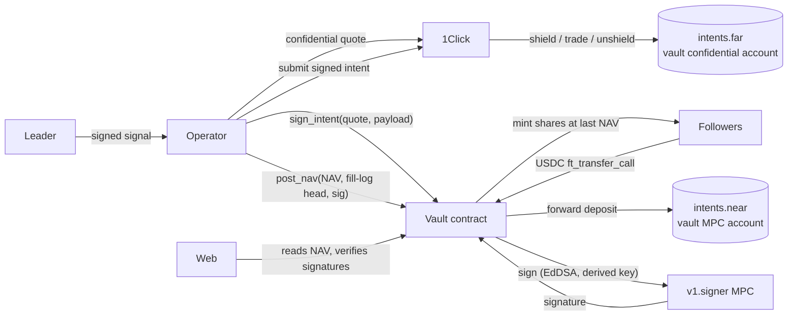

# Silent Partner

**Private copy-trading vaults on NEAR Confidential Intents.** By Scope. Built at the NEAR Hackathon "Build Beyond Boundaries" (tracks: Privacy, DeFi).

**What.** A leader and their followers share one vault. The vault's assets sit in a confidential NEAR Intents account. When the leader sends a trade signal, the operator executes it once, for the whole pool, through a single 1Click confidential quote, so everyone gets the same price. The public sees attested NAV and returns; nobody sees positions.

**Why.** Copy trading on public chains is broken in two ways.
- **Front-running.** Followers' orders land after the leader's, so the leader (or anyone watching) can front-run them and dump into them.
- **Exposure.** A good trader's book is visible to the whole market.

Pooling the funds fixes the first problem: there is one order, so there's no one to dump on. Confidential Intents fixes the second. The remaining risk is custody, and that's what the contract is for.

**How.**
- **[contract/](contract/)** (NEAR, Rust):
  - **Shares.** Deposits mint shares at the last NAV. Withdrawals burn at the next NAV.
  - **Leader rules.** The leader must hold at least 10% of shares. The leader earns a 20% performance fee above a high-water mark.
  - **NAV and signals.** NAV is attested by the operator each epoch. Leader signals are recorded by hash.
  - **Emergency exit.** If no NAV is posted for 24h, holders can exit.
  - **The vault key.** The vault's intents account is an **MPC key derived for the contract** (Chain Signatures, EdDSA). The contract signs only transfers to a 1Click deposit address, taken from a 1Click-signed quote that pays back into the vault or out to a holder's own claim. The operator chooses trades; it cannot take the money.
- **[operator/](operator/)** (TypeScript):
  - verifies leader-signed signals;
  - sizes each trade against NAV and executes it as one confidential quote;
  - keeps a hash-chained fill log (1Click history is invite-only, so the vault records its own);
  - posts signed NAV with the log head;
  - shields deposits and pays withdrawals.
- **[web/](web/)** (Next.js static site):
  - a leaderboard, vault pages with a returns chart, deposit and withdraw, a leader console, and share cards;
  - your browser re-verifies every NAV signature;
  - wallets: MyNearWallet and Meteor.

**Live proof.**
- **[docs/testnet.md](docs/testnet.md):** the full loop on testnet with real testnet MPC signatures. The real NEAR Intents verifier executes a vault transfer signed by the MPC key, and a payout to the wrong account is refused on-chain.
- **[docs/probes/](docs/probes/):** mainnet `intents.near` accepts an MPC-FROST-signed intent (a read-only simulation).
- **[docs/mainnet.md](docs/mainnet.md):** mainnet transactions, once run.
- **[docs/screens/](docs/screens/):** screenshots.

**Run it.**
```sh
make test                                   # contract (30) + operator (25) + web (8) unit tests
make build                                  # wasm, operator, static site in web/out
cd operator && npx tsx --env-file-if-exists=../.env scripts/serve-testnet.ts   # operator on :8788 (testnet, dry 1Click)
cd web && npm run build && npm run serve    # http://localhost:3000, reads the testnet vault live
make e2e                                    # Playwright against live testnet (needs the operator running)
```

---

## Contents

- [How it works](#how-it-works)
- [Trust model in one paragraph](#trust-model-in-one-paragraph)
- [Repository](#repository)
- [Reproduce the testnet run](#reproduce-the-testnet-run)
- [Docs](#docs)

## How it works



1. **Deposit.** A follower sends USDC to the vault with `ft_transfer_call`. The contract mints shares at the book NAV, provided the leader stake stays at least 10% and the NAV is fresh, and forwards the USDC to `intents.near`, credited to the vault's MPC account. The operator then shields it into the confidential account.
2. **Signal.** The leader signs a signal (sell X, buy Y, size as % of NAV, market or limit) with a key registered on the vault. The operator verifies it, sizes it against NAV, gets **one** confidential 1Click quote for the whole vault, and asks the contract to sign the transfer. The contract does four things:
   - verifies 1Click's signature on the quote;
   - checks that the quote pays the vault and refunds the vault;
   - checks that the payload is exactly one transfer of `amountIn` to the quote's deposit address;
   - calls MPC `sign`.

   The operator submits the signed intent, records the fill in its log, and records the signal hash on-chain, where the contract re-verifies the leader's signature.
3. **NAV.** Each epoch the operator computes NAV as holdings valued by 1Click quotes into USDC, minus what open claims are owed. It appends the NAV to the fill log and posts NAV plus the log head, signed by its attestation key. The contract charges the high-water-mark fee by minting leader shares, then burns pending withdrawals at the post-fee price.
4. **Withdraw.** The burned shares become a claim. The contract will sign only an unshield of the base asset to the claim's own exit account, for no more than the claim is still owed.
5. **Emergency.** If no NAV is posted for 24h, anyone can trigger emergency mode. Deposits stop, holders exit at the last NAV, and anyone may submit the unwind and payout quotes, which the contract still binds to the vault and to each claim.

## Trust model in one paragraph

What the operator can't do:
- **It holds no vault key.** The vault key is MPC-derived for the contract, which signs only quote-bound transfers back into the vault or out to a holder's own claim. A malicious operator therefore **cannot steal funds**.

What you still have to trust it for:
- **NAV honesty.** NAV is attested, not proven. A lying operator could misprice deposits and withdrawals between posts. The hash-chained fill log pinned on-chain makes that detectable after the fact, not impossible.
- **Liveness.** If it stops, emergency mode lets holders exit after 24h.
- **Bad trades.** It could trade badly, within the allowed assets and the 1% slippage cap.

What else you trust:
- **1Click and NEAR Intents** for execution and confidentiality.
- **The NEAR MPC network** for the key.
- **The vault account holder.** For the mainnet demo the vault account keeps its full-access key, so the code can be redeployed. Production would delete it.

The full analysis is in [docs/threat-model.md](docs/threat-model.md).

## Repository

| Path | What |
|---|---|
| `contract/src/lib.rs` | Vault: deposits, withdrawals, NAV, fee, emergency, `sign_intent` / `on_signed` |
| `contract/src/intent.rs` | Strict NEP-413 payload parser and prehash (defuse test vector) |
| `contract/src/quote.rs` | 1Click quote signature verification (real 1Click vector) |
| `contract/src/math.rs` | Share math, high-water-mark fee |
| `operator/src/operator.ts` | Signals → execution, shield, epochs and NAV, payouts |
| `operator/src/filllog.ts` | Append-only, hash-chained fill log |
| `operator/src/confidential.ts` | 1Click confidential client (quote, generate-intent, submit-intent, status) |
| `operator/scripts/` | Probes, testnet runs, `op.ts` step CLI for the mainnet runbook |
| `web/app/` | Leaderboard `/`, vault `/vault/?id=`, leader console `/leader/`, share card `/s/?id=` |

Carried over from Scope (copied, not imported): the 1Click client, canonical hashing and signing, quote-signature verification, the copy-vault probes, and the wallet-selector setup. Scope's first commit is dated 2026-11-05, inside the hackathon window. Everything else was written for Silent Partner from 2026-11-07.

## Reproduce the testnet run

```sh
cd operator
# four faucet accounts in data/testnet-accounts.json: {"vault","operator","leader","follower"} (see docs/testnet.md)
cd ../contract && cargo near build non-reproducible-wasm && cd ../operator
npx tsx scripts/testnet-e2e.ts                       # deploy, activate (MPC), deposits, NAV, fee, signal, withdrawal, MPC signatures
npx tsx --env-file-if-exists=../.env scripts/testnet-operator-run.ts   # operator: dry 1Click pricing, real testnet NAV and signals
npx tsx scripts/testnet-intents.ts <near/intents>/releases/defuse-0.2.10.wasm  # real verifier executes the MPC-signed transfer
```

The 1Click partner JWT (`ONECLICK_JWT` in `.env`) is only needed for real 1Click dry quotes. Everything is dry by default (`DRY_RUN=1`). Mainnet writes need `MAINNET_WRITES=1`, and live 1Click needs `MAINNET_LIVE_OK=1`.

## Docs

- [Architecture](docs/architecture.md)
- [Threat model](docs/threat-model.md)
- [Decisions](docs/DECISIONS.md)
- [Status](docs/STATUS.md)
- [Testnet](docs/testnet.md)
- [Mainnet](docs/mainnet.md)
- [Demo script](docs/demo-script.md)
- [1Click kill tests](docs/killtests-copyvault.md)
