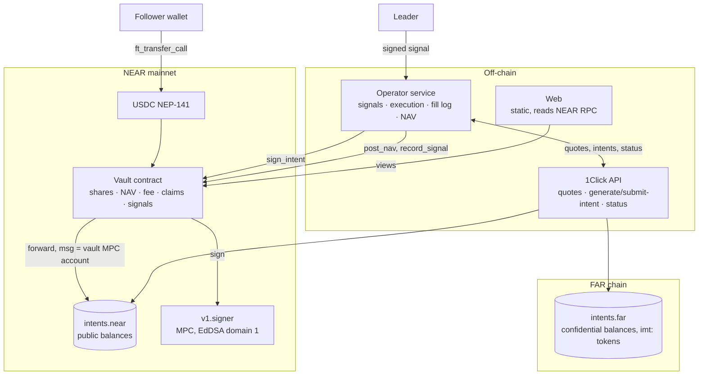

# Architecture

## Components

## The vault key

The vault's intents account is the implicit account of `derived_public_key(path = "silent-partner/vault", predecessor = <vault contract>, domain_id = 1)` on `v1.signer`. There is no private key anywhere. Only the contract, as predecessor, can get MPC signatures for it, and it asks only through `sign_intent`.

- **Where the account comes from.** `activate()` fetches the key from the MPC contract. No party supplies it, so nobody can point deposits at an account they control.
- **Public balance.** Deposits are forwarded to `intents.near` (`ft_transfer_call`, msg = vault account). The operator shields them.
- **Signing.** `sign_intent(kind, payload, quote)` parses the NEP-413 payload strictly, binds it to a 1Click-signed quote, computes the NEP-413 prehash, and calls MPC `sign` with `payload_v2.Eddsa = prehash`. `on_signed` checks the returned signature against the vault key before returning it.

What `sign_intent` accepts:

| Kind | Quote shape | Who may call |
|---|---|---|
| `Login` | none. Payload: empty intents for the public verifier, used for a 1Click session to read balances | operator |
| `Shield` | `INTENTS → CONFIDENTIAL_INTENTS`, same asset, recipient = refundTo = vault | operator; anyone in emergency |
| `Trade` | `CONFIDENTIAL_INTENTS` on all three types, allowed assets, recipient = refundTo = vault, slippage ≤ max | operator; anyone in emergency, to the base asset only |
| `Payout{claim}` | base asset `CONFIDENTIAL_INTENTS → INTENTS`, recipient = the claim's exit account, refundTo = vault, amount ≤ what the claim still has open | operator; anyone for emergency claims |

Every transfer must meet four conditions:
- it is exactly one `transfer` of one token from the vault;
- it pays the quote's `depositAddress` exactly `amountIn`;
- the token is `imt:<treasury>:<originAsset>` on FAR, or `originAsset` on intents.near;
- its deadline is ≤ the quote's and ≤ now + 1h.

Unknown fields such as `memo` or a `msg` notification are rejected.

## Accounting

All amounts are base-asset units (USDC, 6 decimals). Share price = NAV / shares, and a new vault starts at price 1.

- **`book_nav`** = last posted NAV, plus deposits since, minus payouts since. Deposits mint at `amount × shares / book_nav`.
- **`post_nav(epoch, nav, ts, fills_head, sig)`:**
  - the signature must verify under `attestation_key` over `silent-partner/nav/v1|<contract>|<epoch>|<nav>|<ts>|<fills_head>`;
  - fee: if price > HWM, `fee_value = (nav − HWM × shares) × fee_bps`; the leader is minted `fee_value × shares / (nav − fee_value)` shares, and the HWM moves to the post-fee price;
  - then every pending withdrawal burns at the post-fee price and opens a claim.
- **Leader stake.** A follower deposit is refunded if it would leave the leader under `min_leader_bps`. A leader withdrawal request is refused if it would do the same, unless the leader is the last holder.
- **Emergency.** It triggers when `now > last_nav + 24h`. It is sticky. Pending withdrawals become claims at the last NAV, and `emergency_exit` burns all of a holder's shares the same way.

## Operator

- **Signal envelope:** `{signal, signature, public_key}`.
  - The signal is `{v, vault, from, to, size_bps, type, limit_price?, expires_ms?, nonce, created_ms}`.
  - The hash is `sha256(canonicalJson(signal))`, and the leader's key signs the 32 raw bytes.
  - The operator checks: the key equals the vault's `get_signal_key`, the vault matches, the assets are allowed, the signal is under 5 minutes old, and the nonce is unused.
- **Sizing:** `size_bps × NAV`, converted to `from` units at the current quote and capped at the balance. Limit signals wait in the operator and execute when a dry quote crosses the price.
- **Fill log:** JSONL entries `{seq, prev, ts, kind, data, hash}`, where `hash = sha256(canonicalJson({seq, prev, ts, kind, data}))` and the genesis is `sha256("silent-partner/fills/v1|<vault>")`. Kinds are `deposit`, `shield`, `signal`, `fill`, `payout`, `nav` and `note`. The ledger (holdings) is a fold over the log, and the head is posted with every NAV.
- **NAV** = unshielded public base + Σ holdings × dry-quote value in base − (claims owed). The breakdown never leaves the operator.
- **Modes:**
  - `DRY_RUN=1` is paper trading at real 1Click prices, and the vault key is never used.
  - Mainnet chain writes need `MAINNET_WRITES=1`.
  - Live 1Click on mainnet needs `MAINNET_LIVE_OK=1`.

## Web

A static export: every page reads NEAR RPC in the browser.

- **`/`:** leaderboard with return (post-fee price), max drawdown, AUM bucket, epochs, attested count and status.
- **`/vault/?id=`:** chart, NAV posts, deposit, withdraw, your position and claims.
- **`/leader/?id=`:** signal key registration, then signing in the browser and sending to the operator.
- **`/s/?id=`:** share card.

Every NAV signature is re-verified in the browser.
